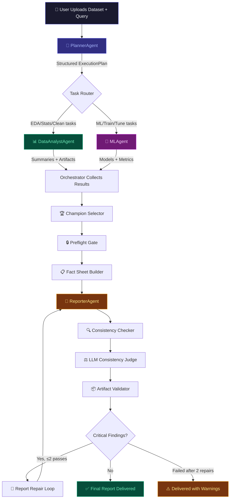

<div align="center">

# 🤖 AnalystGPT

### Multi-Agent AI Data Analyst — End-to-End Automated Analytics & ML Pipeline

[](https://python.org)
[](https://fastapi.tiangolo.com)
[](https://react.dev)
[](https://modal.com)
[](https://logfire.pydantic.dev)

<br/>

> **Upload a dataset → Ask a question → Get a verified executive report with ML models, visualizations, and artifacts — all in one run.**

*Built by **[Dipin Parmar](https://github.com/Dipin-Parmar)***

<br/>


</div>

---

## 📑 Table of Contents

- [Overview](#-overview)
- [Architecture & Flow Diagram](#-architecture--flow-diagram)
- [Project Structure](#-project-structure)
- [Available Agents](#-available-agents)
- [Verification & Quality Gates](#-verification--quality-gates)
- [Two Main Endpoints](#-two-main-endpoints)
- [Token Usage & Budget](#-token-usage--budget)
- [Observability Dashboard](#-observability-dashboard)
- [Sandbox Execution (Modal Cloud)](#-sandbox-execution-modal-cloud)
- [Where Things Are Stored](#-where-things-are-stored)
- [Input Datasets](#-input-datasets)
- [Tech Stack](#-tech-stack)
- [Getting Started](#-getting-started)
- [Usage Guide](#-usage-guide)
- [Testing](#-testing)
- [Environment Variables](#-environment-variables)
- [Known Limitations & Disabled Gates](#-known-limitations--disabled-gates)
- [Credits](#-credits)

---

## 🌟 Overview

**AnalystGPT** is a multi-agent AI system that automates the full data analytics lifecycle. You upload a CSV/XLSX dataset, type a natural-language question (e.g., *"Predict customer churn and identify key drivers"*), and the system:

1. **Plans** — Decomposes your query into a structured execution plan
2. **Analyzes** — Runs EDA, statistical analysis, data cleaning, and feature engineering
3. **Models** — Trains, tunes, and compares ML models with cross-validation
4. **Reports** — Generates a verified executive markdown report with actionable insights
5. **Verifies** — Runs 5 deterministic + LLM-based verification gates to ensure factual accuracy

All code execution happens in a **Modal cloud sandbox** (or locally), and every step is observable through a **real-time Logfire-powered observability dashboard**.

---

## 🏗 Architecture & Flow Diagram

### High-Level Workflow

```
┌─────────────────────────────────────────────────────────────────────────────────┐
│                           AnalystGPT — Workflow Pipeline                        │
└─────────────────────────────────────────────────────────────────────────────────┘

  ┌──────────┐     ┌──────────────┐     ┌────────────────┐     ┌──────────────┐
  │  USER    │────▶│ PlannerAgent │────▶│DataAnalystAgent│────▶│   MLAgent    │
  │ (Query + │     │              │     │                │     │              │
  │ Dataset) │     │ • Decompose  │     │ • EDA          │     │ • Train      │
  │          │     │ • Route tasks│     │ • Clean data   │     │ • Tune (HPT) │
  │          │     │ • Assign     │     │ • Statistics   │     │ • Compare    │
  │          │     │   agents     │     │ • Visualize    │     │ • Evaluate   │
  └──────────┘     └──────┬───────┘     └───────┬────────┘     └──────┬───────┘
                          │                     │                      │
                          ▼                     ▼                      ▼
              ┌───────────────────────────────────────────────────────────────┐
              │                    ORCHESTRATOR (WorkflowOrchestrator)        │
              │                                                              │
              │  • Task routing & sequencing      • Artifact aggregation     │
              │  • Cancellation management        • Memory management        │
              │  • Retry logic (hallucination)    • Run context tracking     │
              │  • Champion model selection        • Sandbox coordination    │
              └──────────────────────────┬────────────────────────────────────┘
                                         │
                                         ▼
              ┌───────────────────────────────────────────────────────────────┐
              │                 POST-TRAINING VERIFICATION PIPELINE          │
              │                                                              │
              │  ┌─────────────┐  ┌───────────────┐  ┌─────────────────┐    │
              │  │  Champion   │  │   Preflight   │  │   Fact Sheet    │    │
              │  │  Selector   │──▶│     Gate      │──▶│    Builder     │    │
              │  │             │  │               │  │               │      │
              │  │ Deterministic│ │ Cross-artifact│  │ Key/value for │      │
              │  │ best-model  │  │ consistency   │  │ the reporter  │      │
              │  └─────────────┘  └───────────────┘  └───────┬───────┘      │
              └──────────────────────────────────────────────┼──────────────┘
                                                              │
                                                              ▼
              ┌───────────────────────────────────────────────────────────────┐
              │                       REPORTER AGENT                         │
              │                                                              │
              │  • Reads all summaries, metrics, artifacts                   │
              │  • Generates executive markdown report                       │
              │  • Uses {{placeholder}} blanks filled from Fact Sheet        │
              │  • Verified metrics injected — reporter never types numbers  │
              └──────────────────────────┬────────────────────────────────────┘
                                         │
                                         ▼
              ┌───────────────────────────────────────────────────────────────┐
              │              FINAL VERIFICATION PIPELINE                     │
              │                                                              │
              │  ┌────────────────┐ ┌──────────────┐ ┌─────────────────┐    │
              │  │  Consistency   │ │   LLM        │ │   Artifact      │    │
              │  │   Checker      │ │ Consistency  │ │   Validator     │    │
              │  │ (Deterministic)│ │   Judge      │ │                 │    │
              │  │                │ │              │ │  • File exists  │    │
              │  │ • Shape checks│ │ • Prose-level│ │  • No phantom   │    │
              │  │ • Phantom cols│ │   audit      │ │    artifacts    │    │
              │  │ • Champion ptr│ │ • Fabrication│ │  • Structure    │    │
              │  │ • Segment     │ │   detection  │ │    validation   │    │
              │  │   grounding   │ │ • Temp=0     │ │                 │    │
              │  └────────────────┘ └──────────────┘ └─────────────────┘    │
              │                                                              │
              │  ┌────────────────────────────────────────────────────────┐  │
              │  │               REPORT REPAIR LOOP (up to 2 passes)     │  │
              │  │  If critical findings → re-prompt reporter → re-verify │  │
              │  └────────────────────────────────────────────────────────┘  │
              └──────────────────────────┬────────────────────────────────────┘
                                         │
                                         ▼
                            ┌─────────────────────────┐
                            │   FINAL EXECUTIVE REPORT │
                            │   + Artifacts Gallery    │
                            │   + Verification Status  │
                            │   + Severity Findings    │
                            └─────────────────────────┘
```

### Detailed Agent Execution Flow



---

## 📂 Project Structure

```
AnalystGPT/
│
├── backend/                       # ⚡ FastAPI backend server
│   ├── app/
│   │   ├── main.py                # FastAPI app — REST API + WebSocket orchestration
│   │   └── parser.py              # CSV/XLSX ingestion and preprocessing
│   ├── api/
│   │   ├── health.py              # GET /api/health — liveness probe
│   │   └── observability.py       # GET /api/observability/* — run logs & metrics API
│   └── utils/                     # Shared backend utilities
│
├── frontend/                      # 🎨 React 18 + Vite + Tailwind CSS dashboard
│   ├── src/                       # React components, hooks, state management
│   ├── index.html                 # SPA entry
│   ├── vite.config.js             # Vite build configuration
│   ├── tailwind.config.js         # Custom design tokens (dark ops-console theme)
│   └── package.json               # Frontend dependencies
│
├── agents/                        # 🧠 Core multi-agent system
│   ├── orchestrate.py             # WorkflowOrchestrator — master coordination (2308 lines)
│   ├── planner_agent.py           # PlannerAgent — query decomposition & task planning
│   ├── data_analyst_agent.py      # DataAnalystAgent — EDA, cleaning, stats, visualization
│   ├── ml_agent.py                # MLAgent — model training, tuning, comparison, evaluation
│   ├── reporter_agent.py          # ReporterAgent — executive report synthesis
│   ├── prompts.py                 # All system prompts for every agent (163k chars)
│   ├── router.py                  # Multi-provider LLM routing (NVIDIA → OpenRouter → Gemini)
│   ├── observability.py           # Unified observability — JSONL logging + Logfire mirroring
│   ├── consistency_checker.py     # Deterministic cross-artifact consistency validation
│   ├── consistency_judge.py       # LLM-based prose-level audit (hybrid verification)
│   ├── numeric_verifier.py        # Deterministic numeric claim verification (DISABLED)
│   ├── preflight_gate.py          # Post-training artifact consistency gate
│   ├── champion_selector.py       # Deterministic best-model selection (goal-aware)
│   ├── artifact_validator.py      # File-existence & structure validation
│   ├── fact_sheet.py              # Key/value fact sheet for reporter (no LLM number typing)
│   ├── memory_manager.py          # Context window management & message sanitization
│   ├── run_context.py             # Dataset profiling & run context builder
│   ├── cancellation.py            # CancellationToken — immediate workflow termination
│   ├── fallback_parser.py         # Robust JSON/response parsing with fallback strategies
│   ├── schema.py                  # Pydantic/dataclass schemas (ModelRegistry, ChampionModel)
│   ├── portkey_routing.py         # Portkey AI gateway routing utilities
│   ├── logger.py                  # Logfire setup and configuration
│   └── tools.py                   # Tool definitions and sandbox manager integration
│
├── sandbox_execution/             # ☁️ Modal cloud sandbox execution engine
│   ├── __init__.py                # Package exports
│   ├── utils.py                   # ModalSandboxManager — cloud container orchestration
│   ├── tool_manager.py            # ToolManager — execute_python tool for agents
│   └── verification_script.py     # build_verified_metrics() — ground-truth computation
│
├── observability_dashboard/       # 📊 Standalone observability UI
│   ├── index.html                 # Dashboard HTML shell
│   ├── app.js                     # Vanilla JS dashboard logic (no deps)
│   └── styles.css                 # Dashboard styling
│
├── uploads/                       # 📁 User-uploaded datasets (CSV/XLSX)
├── outputs/                       # 📁 Per-run output directories (artifacts, reports, models)
├── logs/                          # 📁 Per-run JSONL observability logs
├── workflows/                     # 📁 Saved workflow state (JSON)
├── tests/                         # 🧪 Pytest test suite (14 test files)
│
├── .env.example                   # Environment variable template
├── requirements.txt               # Python dependencies
├── design.md                      # UI design specification document
└── pytest.ini                     # Pytest configuration
```

---

## 🤖 Available Agents

AnalystGPT orchestrates **4 specialized agents**, each with a distinct role:

| Agent | Color | Role | Max Tool Calls | What It Does |
|:------|:------|:-----|:---------------|:-------------|
| **🧠 PlannerAgent** | 🟣 Indigo | Strategist | — (LLM-only) | Analyzes the user's query + dataset metadata, decomposes it into a structured `ExecutionPlan` with ordered tasks, assigns each task to the appropriate agent, and supports plan modification/cancellation |
| **📊 DataAnalystAgent** | 🟢 Emerald | Data Scientist | 7 | Executes data inspection, cleaning, EDA, statistical analysis, feature engineering, and visualization tasks via sandbox code execution. Produces `analyst_summary.json`, charts (`.png`), and processed datasets |
| **🤖 MLAgent** | 🟣 Fuchsia | ML Engineer | 7 | Handles feature preprocessing, model training (Logistic Regression, Random Forest, XGBoost, LightGBM, CatBoost), hyperparameter tuning, cross-validation, metric evaluation, and generates `model_comparison.csv`, `.pkl` model files, confusion matrices, and feature importance plots |
| **📝 ReporterAgent** | 🟡 Amber | Report Writer | 5 | Synthesizes all findings, metrics, and artifacts into a publication-grade executive markdown report. Uses `{{placeholder}}` blanks filled from the Fact Sheet — **the reporter never types or converts a number itself** |

### Agent Routing

The **Router** (`agents/router.py`) implements multi-provider LLM routing with automatic fallback:

```
Priority Order: NVIDIA API → OpenRouter (free models) → Gemini API
                     ↓              ↓                      ↓
            Nemotron 3 Ultra   Nemotron 3 Super       Gemini 3.7 Flash
            Nemotron 3 Super   Nemotron 3 Ultra       Gemini 3.8 Flash
            Llama 3.3 70B      Cohere North Mini
                               Poolside Laguna
```

Each provider is tried in order; if one fails (rate limit, 503, etc.), the next is attempted. All providers use the OpenAI-compatible API surface.

---

## 🔍 Verification & Quality Gates

AnalystGPT runs a **5-layer verification pipeline** after report generation to ensure factual accuracy:

### ✅ Active Gates

| # | Gate | Type | What It Catches |
|:--|:-----|:-----|:----------------|
| 1 | **Preflight Gate** | Deterministic | Runs AFTER training, BEFORE reporter. Validates champion model consistency across all artifacts, confusion matrix round-trips, file existence, row/column counts. Auto-repairs where possible, downgrades failures to warnings |
| 2 | **Consistency Checker** | Deterministic | Cross-artifact reconciliation: contradictory dataset shapes, phantom columns, missing-value contradictions, stale champion pointers, byte-identical duplicate summaries, fabricated segment statistics, drift between computed stats and fresh recomputation |
| 3 | **LLM Consistency Judge** | LLM (Temp=0) | Prose-level audit the deterministic gates cannot see: fabricated capabilities ("well-calibrated probabilities" with no calibration analysis), wrong relationships, claims that modeling/feature engineering occurred when it didn't, mislabeled artifacts. Anti-fabrication filter ensures judge quotes exist verbatim in the report |
| 4 | **Artifact Validator** | Deterministic | Validates that artifacts claimed by agents actually exist in the output directory. Prevents hallucination where agents claim to have generated files that don't exist |
| 5 | **Champion Selector** | Deterministic | Goal-aware best-model selection. Recall-priority goals use Recall → F1 → ROC-AUC ranking; default goals use ROC-AUC → PR-AUC → F1 → Accuracy. The ML agent never decides the champion |

### 🚫 Disabled Gate

| Gate | Reason for Disabling |
|:-----|:---------------------|
| **Numeric Verifier** | Currently **disabled** due to underperformance. It was designed to extract numeric claims from draft reports via regex and cross-reference them against `VERIFIED_METRICS` ground truth. However, it produces too many false positives — flagging benign prose numbers (bucket ranges like "0–12 months", train/test splits like "80/20", file sizes, section headers) as unverified claims, causing unnecessary report repair loops and degrading report quality. The deterministic Consistency Checker and LLM Judge together provide sufficient coverage for numeric accuracy |

### Report Repair Loop

When critical findings are detected, the system enters a **repair loop** (max 2 passes):

```
Report Draft → Verify → Critical findings? → Re-prompt Reporter → Re-verify → Deliver
                 │                                                       │
                 └── No critical findings ──────────────────────────────▶ ✅ Delivered
                                                                         
                 └── Still failing after 2 passes ─────────────────────▶ ⚠️ Delivered with warnings
```

---

## 🔌 Two Main Endpoints

### 1. AnalystGPT Main API — `backend/app/main.py`

The primary FastAPI application powering the entire analytics pipeline.

**Start the server:**
```bash
cd backend/app
uvicorn main:app --host 0.0.0.0 --port 8000 --reload
```

| Endpoint | Method | Description |
|:---------|:-------|:------------|
| `/api/health` | GET | Liveness/readiness probe |
| `/api/datasets` | GET | List all uploaded datasets |
| `/api/upload` | POST | Upload CSV/XLSX dataset(s) |
| `/api/datasets/{name}/preview` | GET | Preview dataset (schema + sample rows) |
| `/api/plan` | POST | Generate an execution plan from query + dataset |
| `/api/plan/confirm` | POST | Confirm and begin executing the plan |
| `/api/plan/modify` | POST | Modify the current plan with instructions |
| `/api/plan/cancel` | POST | Cancel the current plan |
| `/api/workflow/run` | POST | Run the full workflow (plan → execute → verify → report) |
| `/api/workflow/cancel` | POST | Terminate a running workflow immediately |
| `/api/workflow/status` | GET | Current workflow status + findings |
| `/api/workflow/findings` | GET | Verification findings (severity-classified) |
| `/api/report` | GET | Get the final executive markdown report |
| `/api/artifacts` | GET | List all generated artifacts for a run |
| `/api/artifacts/{filename}` | GET | Download a specific artifact |
| `/ws` | WebSocket | Real-time event streaming (agent thoughts, tool runs, status updates) |

**WebSocket Events:**
```
agent_thought     → LLM reasoning text per agent
tool_executing    → Python code about to execute in sandbox
tool_completed    → stdout/stderr/artifacts from sandbox
task_start        → Agent starting a plan task
task_completed    → Agent finished a plan task
verification      → Verification gate results
report_repair     → Repair pass started/completed
workflow_completed → Final status + findings + report
workflow_cancelled → Workflow terminated by user
workflow_failed   → Unrecoverable error
```

### 2. Observability API — `backend/api/observability.py`

Dedicated API for the observability dashboard, serving per-run JSONL logs.

| Endpoint | Method | Description |
|:---------|:-------|:------------|
| `/api/observability/runs` | GET | List all run logs (newest first) + active run ID |
| `/api/observability/runs/{run_id}` | GET | Aggregated metrics for one run (latency, tokens, errors) |
| `/api/observability/runs/{run_id}/events` | GET | Paginated raw events with filters (`level`, `event`, `q` text search) |
| `/api/observability/active` | GET | Live snapshot of the in-memory active run |

---

## 💰 Token Usage & Budget

### Expected Token Consumption Per Full Run

| Metric | Estimated Range |
|:-------|:----------------|
| **Input Tokens** | **1.5M – 2M tokens** (without caching) |
| **Output Tokens** | **200K – 250K tokens** (without caching) |
| **Cachable Tokens** | Viewable on the **Observability Dashboard** under per-run token breakdown |
| **LLM Calls** | ~30–60 calls per full run (varies by plan complexity) |
| **Tool Calls** | 7 max per DataAnalyst/ML agent, 5 max per Reporter agent |
| **Verification Calls** | 1 LLM call (Consistency Judge) + all deterministic gates (no LLM cost) |

> **💡 Tip:** The observability dashboard (`/api/observability/runs/{run_id}`) provides a detailed breakdown of input tokens, output tokens, cachable tokens, latency percentiles, and cost per LLM call for every run.

### Cost Optimization

- **Multi-provider routing** uses free-tier models where possible (OpenRouter `:free` suffix)
- **Smart chunking** limits large payloads to 15K tokens (head + tail, middle dropped)
- **Memory management** sanitizes and compresses message history to stay within context windows
- **Fact Sheet** approach eliminates the reporter re-inventing numbers (fewer correction loops)

---

## 📊 Observability Dashboard

The **standalone observability dashboard** (`observability_dashboard/`) provides a real-time view of all pipeline activity.

### What It Shows

- **Run List** — All historical runs with status, timestamps, file sizes
- **Active Run** — Live polling of the currently executing workflow
- **Per-Run Metrics:**
  - Total LLM calls, tool executions, retries
  - Token breakdown: input / output / cachable
  - Latency percentiles: avg, P50, P90, P95, P99
  - Per-agent breakdown (Planner, DataAnalyst, MLAgent, Reporter)
  - Error rates and failure classifications
- **Event Stream** — Paginated, filterable raw event log with text search
- **Logfire Integration** — All logs are dual-written to Logfire (if configured) for cloud-hosted observability

### Accessing the Dashboard

The observability dashboard is served as static files by the FastAPI backend:

```bash
# Start the backend server (serves both API and dashboard)
cd backend/app
uvicorn main:app --host 0.0.0.0 --port 8000

# Open the observability dashboard
# http://localhost:8000/observability_dashboard/index.html
```

Or open the standalone HTML file directly (requires the API to be running):
```
observability_dashboard/index.html
```

---

## ☁️ Sandbox Execution (Modal Cloud)

All agent code execution (Python scripts for EDA, ML training, visualization) runs inside a **Modal cloud sandbox** — an isolated container with pre-installed data science libraries.

### How It Works

```
Agent writes Python code
        │
        ▼
┌─────────────────────────────────────┐
│ ToolManager.execute_python()        │
│                                     │
│  1. Package input files (datasets)  │
│  2. Upload to Modal container       │
│  3. Execute in sandboxed Python     │
│  4. Capture stdout/stderr           │
│  5. Extract output files            │
│  6. Save artifacts to outputs/      │
└─────────────────────────────────────┘
```

### Pre-installed Sandbox Packages

The Modal container image comes with:
```
pandas, numpy, scipy, matplotlib, seaborn, scikit-learn,
xgboost, lightgbm, catboost, imbalanced-learn, joblib, openpyxl, statsmodels
```

### Enabling Modal Cloud Sandbox

**Step 1: Install Modal**
```bash
pip install modal
```

**Step 2: Authenticate with Modal**
```bash
modal setup
```

**Step 3: Configure `.env`**
```env
# Set sandbox backend to "modal" for cloud execution
SANDBOX_BACKEND=modal

# Set to "true" to allow fallback to local execution if Modal fails
SANDBOX_FALLBACK_TO_LOCAL=false
```

**Step 4: Run the workflow** — the sandbox manager will automatically:
- Build a container image with all data science libraries
- Upload your dataset files to the container
- Execute agent-generated Python code in isolation
- Extract all output files (CSVs, PNGs, PKLs, JSONs) back to your local `outputs/` directory

### Local Execution Fallback

If you don't have Modal configured or prefer local execution:
```env
SANDBOX_BACKEND=local
```

---

## 📁 Where Things Are Stored

| What | Location | Format |
|:-----|:---------|:-------|
| **Uploaded datasets** | `uploads/` | `.csv`, `.xlsx` |
| **Run artifacts** | `outputs/run_YYYYMMDD_HHMMSS/` | CSVs, PNGs, PKLs, JSONs, MD |
| **Observability logs** | `logs/run_YYYYMMDD_HHMMSS_PID.jsonl` | JSONL (one JSON object per line) |
| **Workflow state** | `workflows/` | JSON |
| **Final report** | `outputs/run_.../final_report.md` | Markdown |
| **Model artifacts** | `outputs/run_.../logistic_regression_p0.pkl`, etc. | Pickle |
| **Model comparison** | `outputs/run_.../model_comparison.csv` | CSV |
| **Champion model** | `outputs/run_.../champion_model.json` | JSON |
| **Model registry** | `outputs/run_.../model_registry.json` | JSON |
| **Visualizations** | `outputs/run_.../feature_importance.png`, etc. | PNG |
| **Dataset profile** | `outputs/run_.../dataset_profile.json` | JSON |
| **Analyst summaries** | `outputs/run_.../analyst_summary.json` | JSON |
| **ML summaries** | `outputs/run_.../ml_summary.json` | JSON |
| **Verified metrics** | `outputs/run_.../verified_metrics.json` | JSON |
| **Fact sheet** | `outputs/run_.../fact_sheet.json` | JSON |
| **Consistency report** | `outputs/run_.../consistency_report.json` | JSON |

### Log File Structure (JSONL)

Each line in a log file is a JSON object:
```json
{
  "ts": "2026-10-15T17:43:38.123456",
  "run_id": "run_20261015_174338_5660",
  "event": "llm_call",
  "level": "info",
  "agent": "DataAnalystAgent",
  "task_id": "task_1",
  "input_tokens": 45230,
  "output_tokens": 1847,
  "latency_s": 12.34,
  "model": "nvidia/nemotron-3-ultra-550b-a55b",
  "provider": "nvidia"
}
```

---

## 📊 Input Datasets

Sample datasets are included in the `uploads/` directory for testing:

| Dataset | Size | Rows | Description |
|:--------|:-----|:-----|:------------|
| `Telco_customer_churn.csv` | 1.7 MB | ~7,000 | Telecom customer churn dataset |
| `WA_Fn-UseC_-Telco-Customer-Churn.csv` | 955 KB | ~7,043 | IBM Telco churn (Watson Analytics) |
| `customer_churn_dataset.csv` | 12 KB | ~500 | Small churn dataset |
| `Airbnb_Open_Data.csv` | 34 MB | ~100K+ | Airbnb listings data |
| `online_retail_II.csv` | 44 MB | ~500K+ | E-commerce transaction data |
| `creditcard.csv` | 98 MB | ~285K | Credit card fraud detection |

> **Note:** These datasets are used for testing and demonstration. Upload any CSV or XLSX file through the UI or API to analyze your own data.

---

## ⚙️ Tech Stack

### Backend & Core

| Technology | Purpose |
|:-----------|:--------|
| **Python 3.10+** | Core runtime |
| **FastAPI** | REST API + WebSocket server |
| **Uvicorn** | ASGI server |
| **OpenAI SDK** | LLM provider interface (OpenAI-compatible) |
| **Modal** | Cloud sandbox code execution |
| **Logfire** | Observability & distributed tracing |
| **Pandas / NumPy / SciPy** | Data manipulation & analysis |
| **scikit-learn** | ML modeling & evaluation |
| **XGBoost / LightGBM / CatBoost** | Gradient boosting models |
| **imbalanced-learn** | SMOTE & class imbalance handling |
| **Matplotlib / Seaborn** | Visualization |

### Frontend

| Technology | Purpose |
|:-----------|:--------|
| **React 18** | UI framework |
| **Vite** | Build tooling |
| **Tailwind CSS 3** | Styling (custom dark theme tokens) |
| **Lucide React** | Icon system |
| **react-markdown + remark-gfm** | Report rendering |
| **WebSocket** | Real-time event streaming |

### LLM Providers (Multi-Provider Routing)

| Provider | Models Used |
|:---------|:------------|
| **NVIDIA API** | Nemotron 3 Ultra 550B, Nemotron 3 Super 120B, Llama 3.3 70B |
| **OpenRouter** | Nemotron 3 Super/Ultra (free), Cohere North Mini, Poolside Laguna |
| **Google Gemini** | Gemini 3.7 Flash, Gemini 3.8 Flash |

---

## 🚀 Getting Started

### Prerequisites

- Python 3.10+
- Node.js 18+ (for frontend)
- Modal account (for cloud sandbox — optional)

### Installation

```bash
# 1. Clone the repository
git clone https://github.com/Dipin-Parmar/AnalystGPT.git
cd AnalystGPT

# 2. Create and activate virtual environment
python -m venv venv
# Windows:
venv\Scripts\activate
# macOS/Linux:
source venv/bin/activate

# 3. Install Python dependencies
pip install -r requirements.txt

# 4. Set up environment variables
cp .env.example .env
# Edit .env with your API keys (see Environment Variables section)

# 5. (Optional) Set up Modal for cloud sandbox
pip install modal
modal setup

# 6. Install frontend dependencies
cd frontend
npm install
cd ..
```

### Running the Application

```bash
# Terminal 1: Start the FastAPI backend
cd backend/app
uvicorn main:app --host 0.0.0.0 --port 8000 --reload

# Terminal 2: Start the React frontend
cd frontend
npm run dev
# → Opens at http://localhost:5173
```

---

## 🎮 Usage Guide

### Step-by-Step Process

```
1️⃣  Upload Dataset     →  Drag & drop CSV/XLSX into the upload zone
2️⃣  Enter Query        →  "Predict customer churn and identify key drivers"
3️⃣  Plan Tasks         →  Click "Plan Tasks" — PlannerAgent generates an execution plan
4️⃣  Review Plan        →  Review task breakdown, modify if needed, confirm
5️⃣  Run Workflow       →  Click "Run Workflow" — watch agents execute live
6️⃣  Monitor Progress   →  Agent Console shows real-time thoughts, code, results
7️⃣  Review Report      →  Executive report + verification findings + artifacts
8️⃣  Download Artifacts →  Download charts, models, CSVs, report
```

### UI Layout

```
┌──────────────────────────────────────────────────────────────────┐
│ Navbar: [Logo] [Agent Pills: Planner|Analyst|ML|Reporter] [Status]│
├──────────────────────────────────────────────────────────────────┤
│ Query & Action Bar: [Input] [Plan Tasks] [Run Workflow]          │
├──────────────┬───────────────────────────────────────────────────┤
│ LEFT SIDEBAR │ RIGHT WORKSPACE                                    │
│              │                                                    │
│ • Dataset    │ Tab 1: Plan Viewer + Agent Live Console            │
│   Uploader   │ Tab 2: Findings Panel + Report + Artifacts Gallery │
│ • Quick Stats│                                                    │
└──────────────┴───────────────────────────────────────────────────┘
```

---

## 🧪 Testing

The project includes a comprehensive test suite with **14 test files**:

```bash
# Run all tests
pytest

# Run specific test categories
pytest tests/test_consistency_checker.py     # Cross-artifact consistency checks
pytest tests/test_consistency_judge.py       # LLM judge verification
pytest tests/test_plan_verification.py       # Plan structure validation
pytest tests/test_preflight_factsheet.py     # Preflight gate + fact sheet
pytest tests/test_post_ml_verification.py    # Post-ML model validation
pytest tests/test_segment_grounding.py       # Segment statistics grounding
pytest tests/test_numeric_verifier.py        # Numeric claim verification
pytest tests/test_observability.py           # Observability module tests
pytest tests/test_run_context.py             # Run context builder tests
pytest tests/test_fallback_parser.py         # JSON parsing fallback tests
pytest tests/test_verification.py            # General verification tests
pytest tests/test_pause_resume.py            # Workflow pause/resume tests
pytest tests/test_sandbox_file_preservation.py  # Sandbox file handling
pytest tests/test_fixes_validator_report_threshold.py  # Validator thresholds
```

---

## 🔐 Environment Variables

Create a `.env` file based on `.env.example`:

```env
# LLM Provider API Keys (at least one required)
OPENROUTER_API_KEY=your-api-key        # OpenRouter (legacy single key)
OPENROUTER_API_KEY_1=your-api-key      # OpenRouter key 1 (recommended)
OPENROUTER_API_KEY_2=your-api-key      # OpenRouter key 2 (fallback)

GEMINI_API_KEY_1=your-api-key          # Google Gemini key 1
GEMINI_API_KEY_2=your-api-key          # Google Gemini key 2

NVIDIA_API_KEY=your-api-key            # NVIDIA API key

# Sandbox Configuration
SANDBOX_BACKEND=modal                  # "modal" for cloud | "local" for local execution
SANDBOX_FALLBACK_TO_LOCAL=false        # Allow fallback from Modal to local

# Optional: Override default models
NVIDIA_MODEL=nvidia/nemotron-3-ultra-550b-a55b
OPENROUTER_MODEL=nvidia/nemotron-3-super-120b-a12b:free
GEMINI_MODEL=gemini-3.7-flash
```

---

## ⚠️ Known Limitations & Disabled Gates

| Item | Status | Details |
|:-----|:-------|:--------|
| **Numeric Verifier** | 🚫 Disabled | Too many false positives on prose numbers (ranges, splits, file sizes, headers). The Consistency Checker + LLM Judge cover numeric accuracy sufficiently |
| **Token Budget** | ⚠️ High | A full run consumes ~1.5–2M input tokens — use free-tier providers or caching to manage costs |
| **Single Dataset** | ⚠️ Limited | Multi-dataset joins are supported but complex cross-dataset queries may require plan modification |
| **Report Repair** | ⚠️ Max 2 Passes | If critical findings persist after 2 repair passes, the report is delivered with warnings |

---

## 🙏 Credits

<div align="center">

### Built with ❤️ by **Dipin Parmar**

| | |
|:--|:--|
| **Creator & Builder** | Dipin Parmar |
| **Architecture** | Multi-Agent Orchestration with Verification Pipeline |
| **Design Philosophy** | "Trust but verify" — every claim is deterministically or LLM-audited |

</div>

---

## 🤝 Contributors & Community

<div align="center">

**AnalystGPT is open for everyone — use it, break it, improve it, scale it. 🚀**

</div>

We believe in building in the open. Whether you're a student, a data scientist, or a senior engineer — your contributions matter. Here's how you can help take AnalystGPT to the next level:

| How to Contribute | Description |
|:-------------------|:------------|
| 🐛 **Report Bugs** | Found something broken? Open an issue with reproduction steps |
| 💡 **Suggest Features** | Have an idea for a new agent, verification gate, or UI improvement? Let's discuss it |
| 🔧 **Submit Pull Requests** | Fork the repo, make your changes, and open a PR — all contributions are reviewed and welcomed |
| 📖 **Improve Documentation** | Help make the docs clearer, add examples, or translate to other languages |
| 🧪 **Add Tests** | More test coverage = more confidence. Write tests for uncovered modules |
| 🚀 **Scale It Up** | Help integrate new LLM providers, add new agent types, support more data formats, or optimize token usage |
| 🔍 **Strengthen Verification** | Build better verification gates, fix the Numeric Verifier, or add new quality checks |
| 🎨 **Enhance the UI** | Redesign components, add dark/light theme toggle, improve mobile responsiveness |

### How to Submit a Pull Request

```bash
# 1. Fork the repository on GitHub
# 2. Clone your fork
git clone https://github.com/YOUR_USERNAME/AnalystGPT.git
cd AnalystGPT

# 3. Create a feature branch
git checkout -b feature/your-amazing-feature

# 4. Make your changes and commit
git add .
git commit -m "feat: add your amazing feature"

# 5. Push to your fork
git push origin feature/your-amazing-feature

# 6. Open a Pull Request on the main repository
```

### Areas Where We Need Help the Most

- 🏗️ **Scaling to production** — Kubernetes deployment, horizontal scaling, job queues
- 🧠 **New agent types** — StatisticalTestAgent, TimeSeriesAgent, NLPAgent, AnomalyDetectionAgent
- 🔗 **Data connectors** — SQL databases, cloud storage (S3, GCS), APIs, streaming data
- ⚡ **Performance** — Token caching, parallel agent execution, incremental runs
- 🌍 **Multi-language support** — Reports in different languages
- 🔒 **Security hardening** — Auth, RBAC, audit logging, sandbox escape prevention

> **Every line of code you contribute helps make AI-powered analytics accessible to everyone.**
>
> *— Dipin Parmar*

---

<div align="center">
<sub>Built with Python, FastAPI, React, Modal, and a lot of verification gates 🔒</sub>
<br/>
<sub>⭐ Star this repo if you find it useful — it helps others discover AnalystGPT!</sub>
</div>
